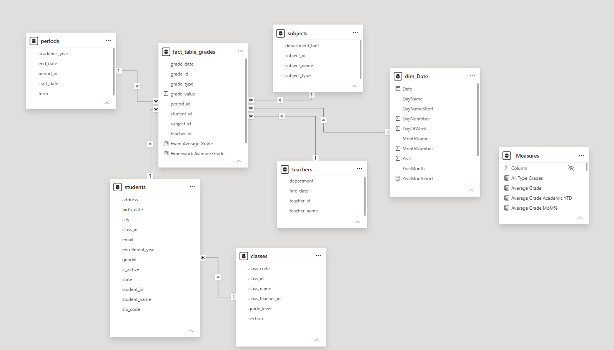
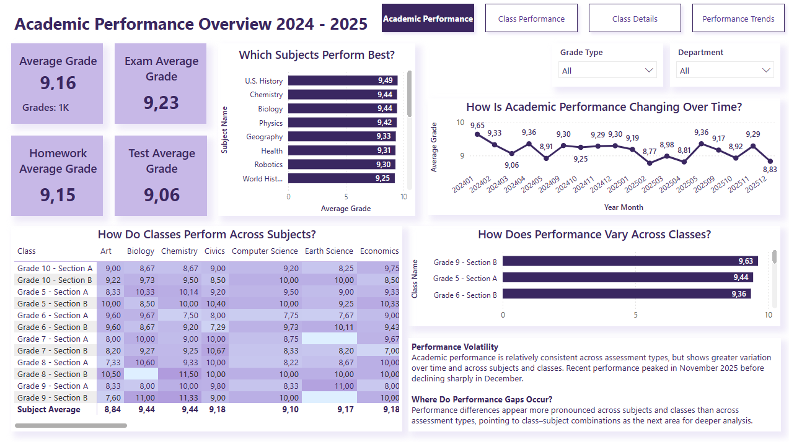
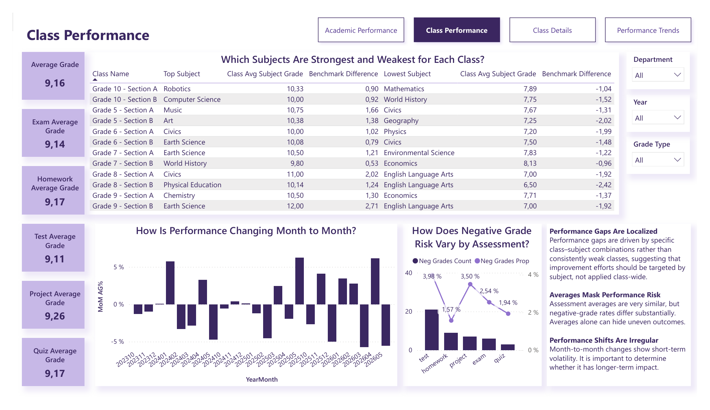
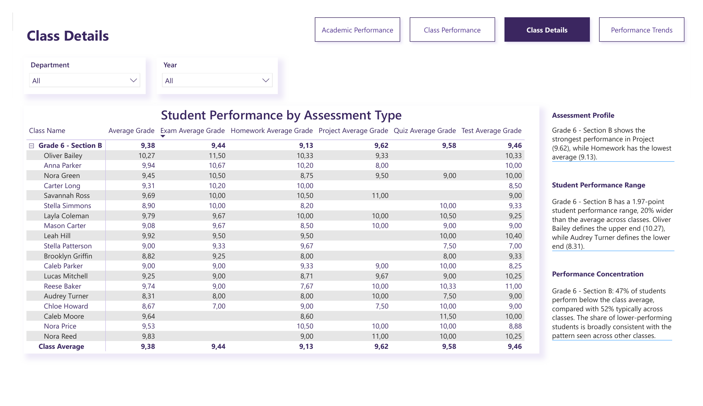
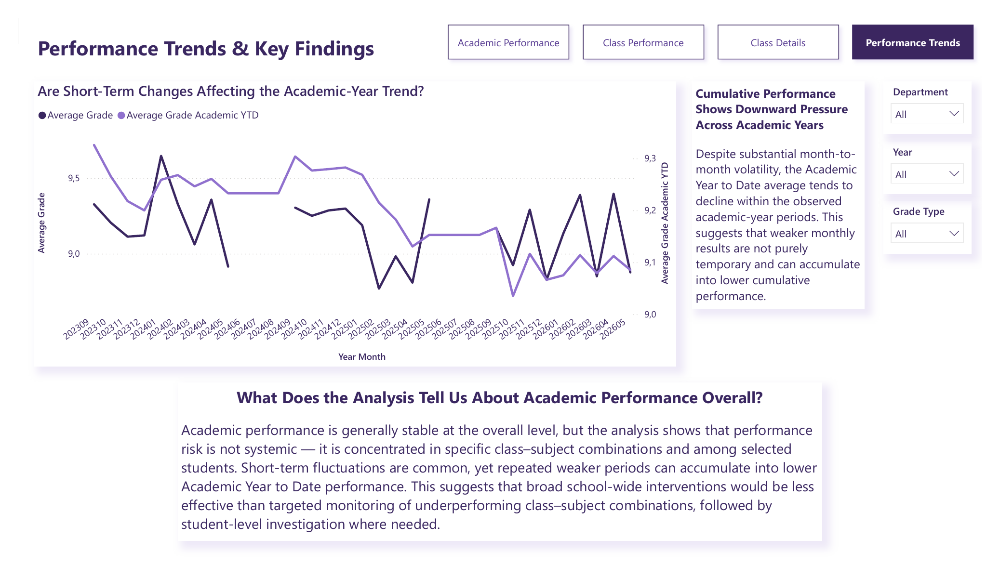

# Academic Performance Analytics — Power BI

Course project (GoIT Data Analytics). The dataset is synthetic and was provided by the course; all student and teacher names are fictional.

## Business context

A school is introducing an electronic grade book. Management wants to understand:

- how to organize data about students, classes, teachers and grades;
- how to build one analytical model for all of this data;
- where academic performance is strong or weak, and how it changes over time.

My role: take the data through the full analytical cycle in Power BI, from raw CSV files to an interactive dashboard with findings and recommendations.

## Data and model

Six raw CSV files (`students`, `classes`, `teachers`, `subjects`, `periods`, `grades`) were cleaned in Power Query and modeled around one fact table (star schema with one snowflaked branch):

- fact table: `fact_table_grades` (one row per grade);
- dimensions linked directly to the fact table: `students`, `teachers`, `subjects`, `periods`;
- `classes` is linked through `students` (one class has many students);
- calendar table: `dim_Date` for time analysis;
- all measures are stored in a separate `_Measures` table.



## Dashboard

Four pages with button navigation, plus a tooltip page and drill-through.

| Page | Question it answers |
|---|---|
| Academic Performance | Which subjects and classes perform best, and how does performance change over time? (Jan 2024 – Dec 2025) |
| Class Performance | What are each class's strongest and weakest subjects, and where is the risk of negative grades? |
| Class Details (drill-through) | How do individual students in a class perform across assessment types? |
| Performance Trends | Do short-term changes affect the academic-year trend? |

**Note on time periods:** the Academic Performance page covers **January 2024 – December 2025** only (a page-level filter on calendar years 2024 and 2025), so it has no Year slicer. All other pages cover the full period in the data and can be filtered by academic year. This is why the KPI cards on the first page differ slightly from those on the other pages.






## What I built

- **Data preparation:** cleaning and type fixes in Power Query.
- **Data model:** star schema with correct relationships and a calendar table.
- **DAX measures with different filter-context behaviour**, for example:
  - averages by assessment type (exam, homework, test, project, quiz);
  - strongest / lowest subject per class and its difference from the subject benchmark;
  - negative-grade count and share;
  - month-over-month change (MoM %) and academic-year-to-date average (YTD).
- **Interactivity:** slicers, cross-filtering between visuals, a report-page tooltip and drill-through to class details.

Example measure:

comparing a class's strongest subject with the school-wide average for the same subject.

```dax
-- Average grade of the class in its strongest subject
Top Subject Class Avg =
VAR StrongestSubject = [Top Subject]
RETURN
    CALCULATE(
        [Average Grade],
        REMOVEFILTERS(subjects[subject_name]),
        TREATAS({ StrongestSubject }, subjects[subject_name])
    )

-- School-wide average for the same subject (class filter removed)
Top Subject School Avg =
VAR StrongestSubject = [Top Subject]
RETURN
    CALCULATE(
        [Average Grade],
        REMOVEFILTERS(classes),
        REMOVEFILTERS(subjects[subject_name]),
        TREATAS({ StrongestSubject }, subjects[subject_name])
    )

-- How much the class outperforms the school benchmark in that subject
Top vs Subject Avg =
[Top Subject Class Avg] - [Top Subject School Avg]
```
```

## Key findings

- Overall performance is stable (average grade about 9.2) and similar across assessment types.
- Performance gaps are localized: they come from specific class–subject combinations, not from consistently weak classes.
- Averages hide risk: assessment averages are close, but negative-grade rates differ noticeably (from about 1.6% to 4%).
- Month-to-month changes are volatile, and the academic-year-to-date average tends to decline within the observed years.

**Recommendation:** instead of school-wide interventions, monitor underperforming class–subject combinations and follow up at student level where needed.

## Files

- `Power_BI_Portfolio_Vitaliia_Girka_Academic_Performance.pbix` — Power BI report
- `Power_BI_Portfolio_Vitaliia_Girka_Academic_Performance.pdf` — PDF export of all pages
- `images/` — screenshots

## Tools

Power BI Desktop · Power Query · DAX
